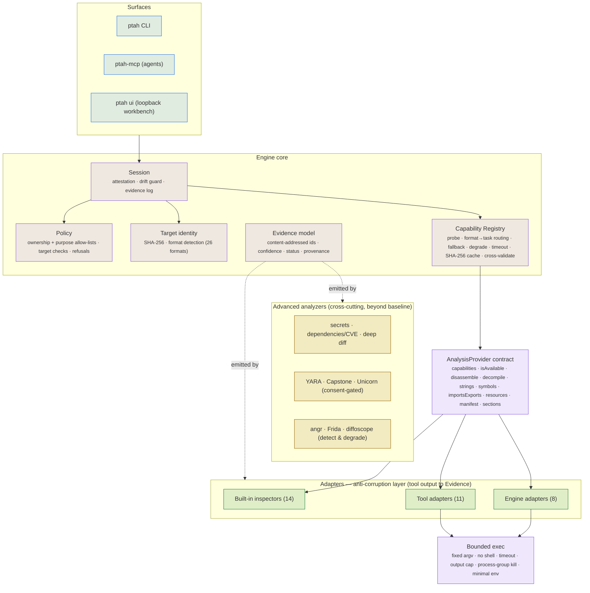

# PTAH Engine

**Evidence-first program analysis.** A self-contained core that identifies a
target, routes it to the best available analyzer, and returns **Evidence** —
every finding bound to the target's SHA-256, labelled by how it was obtained
(`observed` / `derived` / `inferred`), and reproducible byte-for-byte. It
never executes a target except in a consent-gated sandbox.

- **Zero runtime dependencies.** Pure Node.js; nothing in `package.json`.
- **No analyzer lock-in.** 33 providers (tools, engines, built-in parsers)
  behind one contract, with automatic fallback and safe degradation.
- **Parity plus more.** Covers the formats and tools of the inherited
  baseline analyzer 1:1, and adds YARA, Capstone, Unicorn, CVE/secret
  scanning, deep diff, and cross-validation on top.

---

## Architecture



**Flow:** a session opens a target, policy accepts ownership + purpose, the
registry probes providers and builds a `format to task to providers` table,
each `run(task)` picks the best available provider and falls back on failure,
and a drift guard aborts if the target changes mid-analysis. Every result is an
Evidence object.

---

## Guarantees (enforced in code, each with a test)

| Guarantee                                                              | Where                      |
| ---------------------------------------------------------------------- | -------------------------- |
| No analysis without recorded ownership and an allow-listed purpose     | `policy.mjs`, `engine.mjs` |
| Target checks (e.g. org blocklists) can refuse a target                | `evaluateTarget`           |
| Evidence is bound to the target SHA-256; drift aborts the session      | `engine.mjs`               |
| Evidence ids are content-derived; edited evidence is rejected          | `evidence.mjs`             |
| Byte-stable output (canonical JSON, code-point sort, `<target>` paths) | `canonical.mjs`            |
| Tools run with fixed argv, no shell, timeout, capped output            | `exec.mjs`                 |
| Best provider, automatic fallback, `unavailable` instead of a crash    | `registry.mjs`             |
| A hung provider is bounded; an uninstalled one is demoted              | `registry.mjs`             |
| Emulation refuses to run without explicit consent                      | `analyzers.mjs`            |
| No dependency on the inherited baseline runtime                        | whole package              |

---

## Quick start

```js
import { createDefaultRegistry, createEngine } from "@owlvisions/ptah-engine";

const engine = createEngine({ registry: createDefaultRegistry() });
const session = await engine.open("/path/to/target", {
  ownership: "owner", // owner | licensed | authorized | open-source
  purpose: "interoperability", // see PURPOSES in policy.mjs
  statement: "our own release build",
});

const result = await session.run("importsExports");
// -> { provider, evidence: [ { confidence, status, summary, data } ], attempts }

const cross = await session.crossValidate("symbols"); // corroborate across engines
```

Tasks: `manifest`, `sections`, `symbols`, `importsExports`, `strings`,
`disassemble`, `decompile`, `resources`.

---

## Capability matrix (measured)

33 providers — **11 tool, 8 engine, 14 built-in** — across **26 formats** and 8
tasks, plus 9 advanced analyzers. Full detail: [CAPABILITY-MATRIX.md](CAPABILITY-MATRIX.md).

| Area               | Providers                                                                                                     |
| ------------------ | ------------------------------------------------------------------------------------------------------------- |
| Native binaries    | readelf, objdump, nm, gdb, radare2, rizin, Ghidra, Mach-O inspector, (IDA/Hopper/Kuna via your install)       |
| Android / JVM      | aapt2, apktool, JADX, APK-signature inspector, archive inspector, (JEB via your install), adb device analyzer |
| Managed / VM       | monodis (.NET), IL2CPP inspector, BEAM inspector, pyc inspector                                               |
| Web / scripting    | wasm-objdump, WASM/EVM inspectors, ASAR (Electron) inspector                                                  |
| Models / data      | GGUF, safetensors, SQLite, Godot PCK inspectors                                                               |
| Firmware / network | binwalk, unblob, tshark                                                                                       |
| Toolchain ID       | Go, Rust, Flutter, PyInstaller detectors                                                                      |
| Beyond baseline    | YARA, Capstone, Unicorn, secrets, dependencies/CVE, deep diff, cross-validation                               |

Commercial engines (IDA, Hopper, JEB, Kuna) are **never bundled**. Their
adapters ship the headless export scripts and call _your_ licensed install via
`PTAH_IDA_BINARY` / `PTAH_HOPPER_BINARY` / `PTAH_JEB_BINARY` / `PTAH_KUNA_BINARY`.

---

## Benchmark & comparison

- [BENCHMARK.md](BENCHMARK.md) — a timed run over the test fixtures (measured on
  the host; no fabricated figures).
- [HEAD-TO-HEAD.md](HEAD-TO-HEAD.md) — the engine vs the inherited baseline on
  identical targets: identity and sections agree, the engine is markedly faster
  at the comparable operations, and analysis depth is selectable per run.

---

## Roadmap

[ROADMAP-50.md](ROADMAP-50.md) — 50 improvements to surpass every comparable
tool, executed in tested batches (nothing is "done" without a passing test).

## Tests

```sh
node --test engine/test/*.test.mjs   # 51 engine tests
```
