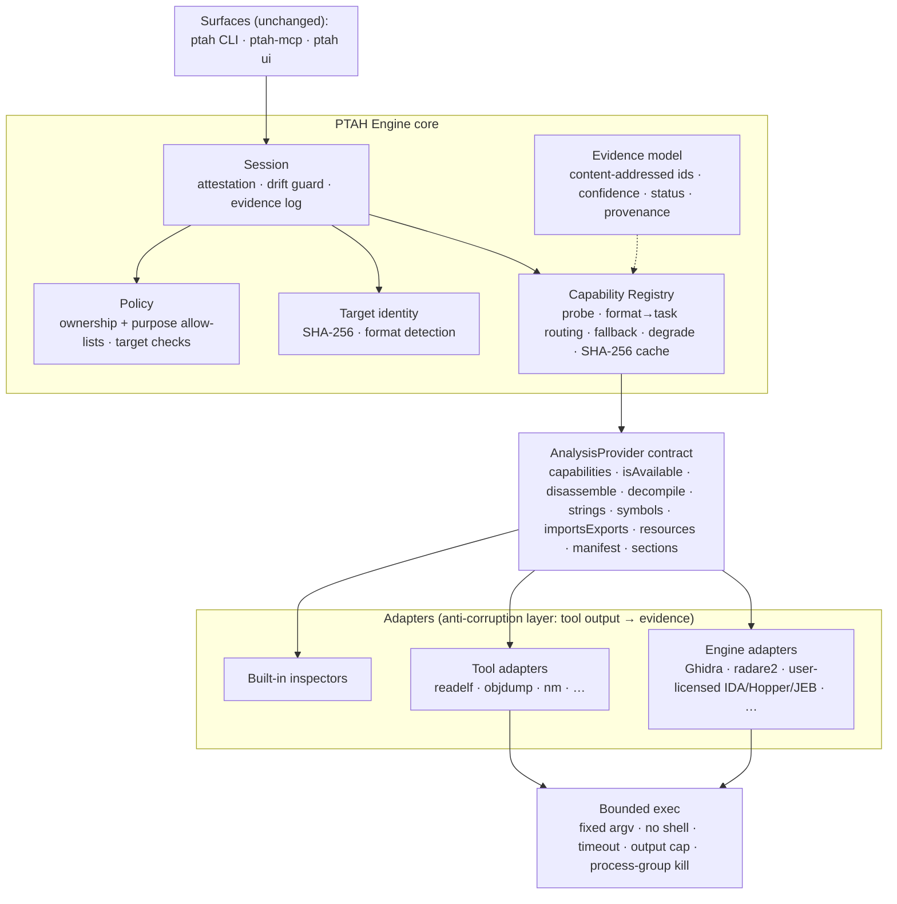

# PTAH Engine

A self-contained, evidence-first analysis core. It has no runtime
dependencies and imports nothing outside this directory (enforced by
`test/core.test.mjs`); external analysis tools are called directly through
PTAH's own adapters.

## Layers



## Guarantees enforced in code

| Guarantee                                                                                     | Where                              | Test                                 |
| --------------------------------------------------------------------------------------------- | ---------------------------------- | ------------------------------------ |
| No analysis without recorded ownership and an allow-listed purpose                            | `src/policy.mjs`, `src/engine.mjs` | `core.test.mjs`                      |
| Organization target checks can refuse a target                                                | `evaluateTarget`                   | `core.test.mjs`                      |
| Evidence is bound to the target SHA-256; drift aborts the session                             | `src/engine.mjs`                   | `core.test.mjs`                      |
| Evidence ids are content-derived; edited evidence is rejected                                 | `src/evidence.mjs`                 | `core.test.mjs`                      |
| Byte-stable output: canonical JSON, code-point ordering, machine paths replaced by `<target>` | `src/canonical.mjs`, adapters      | `core.test.mjs`, `binutils.test.mjs` |
| Tools run with fixed argv, no shell, timeout, capped output                                   | `src/exec.mjs`                     | `core.test.mjs`                      |
| Best available provider, automatic fallback, `unavailable` evidence instead of crashes        | `src/registry.mjs`                 | `core.test.mjs`, `binutils.test.mjs` |
| No REA dependency                                                                             | whole package                      | `core.test.mjs`                      |

## Usage

```js
import { createDefaultRegistry, createEngine } from "@owlvisions/ptah-engine";

const engine = createEngine({ registry: createDefaultRegistry() });
const session = await engine.open("/path/to/target", {
  ownership: "owner", // owner | licensed | authorized | open-source
  purpose: "interoperability", // see PURPOSES in src/policy.mjs
  statement: "Our own release build",
});
const { evidence, provider, attempts } = await session.run("importsExports");
```

## Provider status

| Provider                | Kind    | Formats                        | Tasks                                                             | License                    | Status                                           |
| ----------------------- | ------- | ------------------------------ | ----------------------------------------------------------------- | -------------------------- | ------------------------------------------------ |
| readelf                 | tool    | elf                            | manifest, sections, symbols, importsExports                       | GPL-3.0-or-later           | tested live                                      |
| objdump                 | tool    | elf, pe                        | disassemble, sections                                             | GPL-3.0-or-later           | tested live (ELF)                                |
| nm                      | tool    | elf, pe                        | symbols, importsExports                                           | GPL-3.0-or-later           | tested live (ELF)                                |
| aapt2                   | tool    | apk                            | manifest                                                          | Apache-2.0                 | tested live                                      |
| apktool                 | tool    | apk, aab                       | manifest, resources                                               | Apache-2.0                 | tested live                                      |
| jadx                    | tool    | apk, aab, dex, jar, java-class | decompile, strings                                                | Apache-2.0                 | tested live                                      |
| wasm-objdump            | tool    | wasm                           | sections, importsExports, disassemble                             | Apache-2.0                 | tested live                                      |
| monodis                 | tool    | dotnet                         | manifest, symbols, importsExports, disassemble                    | MIT                        | tested live                                      |
| binwalk                 | tool    | unknown, bin                   | resources                                                         | MIT                        | tested live                                      |
| unblob                  | tool    | unknown, bin                   | resources                                                         | MIT                        | tested live                                      |
| tshark                  | tool    | pcap, pcapng                   | resources                                                         | GPL-2.0-or-later           | tested live                                      |
| radare2                 | engine  | elf, pe, macho, dex            | manifest, sections, symbols, importsExports, strings, disassemble | LGPL-3.0-only              | tested live (ELF)                                |
| rizin                   | engine  | elf, pe, macho, dex            | same as radare2, one priority lower (fallback)                    | LGPL-3.0-only              | tested live (ELF)                                |
| ghidra                  | engine  | elf, pe, macho, dex            | decompile, symbols                                                | Apache-2.0                 | tested live (ELF)                                |
| ida                     | engine  | elf, pe, macho                 | decompile, symbols                                                | commercial (user-licensed) | adapter; PTAH_IDA_BINARY + PTAH_IDA_SCRIPT       |
| hopper                  | engine  | elf, pe, macho                 | decompile                                                         | commercial (user-licensed) | adapter; PTAH_HOPPER_BINARY + PTAH_HOPPER_SCRIPT |
| jeb                     | engine  | apk, aab, dex                  | decompile                                                         | commercial (user-licensed) | adapter; PTAH_JEB_BINARY + PTAH_JEB_SCRIPT       |
| kuna                    | engine  | elf, pe, macho                 | symbols                                                           | user-provided              | adapter; PTAH_KUNA_BINARY                        |
| macho-inspector         | builtin | macho                          | manifest, sections, importsExports, symbols                       | MIT                        | tested (synthetic)                               |
| gguf-inspector          | builtin | gguf                           | manifest                                                          | MIT                        | tested (synthetic)                               |
| safetensors-inspector   | builtin | safetensors                    | manifest                                                          | MIT                        | tested (synthetic)                               |
| sqlite-inspector        | builtin | sqlite                         | manifest                                                          | MIT                        | tested (synthetic)                               |
| godot-pck-inspector     | builtin | godot-pck                      | manifest, resources                                               | MIT                        | tested (synthetic)                               |
| beam-inspector          | builtin | beam                           | manifest, sections                                                | MIT                        | tested (synthetic)                               |
| evm-inspector           | builtin | evm                            | manifest, disassemble                                             | MIT                        | tested (synthetic)                               |
| il2cpp-inspector        | builtin | il2cpp-metadata                | manifest (versions 24/27/29/31/39)                                | MIT                        | tested (synthetic)                               |
| toolchain-inspector     | builtin | elf, pe, macho                 | manifest (Go, Rust, Flutter, PyInstaller)                         | MIT                        | tested live (Go: gh binary)                      |
| archive-inspector       | builtin | zip, jar, apk, aab, ipa        | resources                                                         | MIT                        | tested (apk/zip)                                 |
| asar-inspector          | builtin | asar                           | manifest, resources                                               | MIT                        | tested (synthetic)                               |
| apk-signature-inspector | builtin | apk, aab                       | manifest                                                          | MIT                        | tested live (matches apksigner v1/v2/v3)         |
| ips-inspector           | builtin | ips                            | manifest                                                          | MIT                        | tested (synthetic)                               |
| pyc-inspector           | builtin | pyc                            | manifest                                                          | MIT                        | tested (synthetic)                               |

## Advanced analyzers (beyond REA)

Cross-cutting analyzers that work on bytes, dependency manifests, or a pair of
targets rather than one format's tasks. Each returns Evidence.

| Analyzer                  | Kind    | Beyond REA | License / tool                 | Status                                   |
| ------------------------- | ------- | ---------- | ------------------------------ | ---------------------------------------- |
| secrets                   | builtin | no         | MIT                            | tested; values redacted, never stored    |
| dependencies / CVE        | builtin | yes        | MIT                            | tested; offline advisory set, no network |
| deep diff                 | builtin | yes        | MIT                            | tested; deterministic                    |
| yara                      | tool    | yes        | BSD-3-Clause (yara)            | tested live                              |
| capstone                  | tool    | yes        | BSD-3-Clause (python capstone) | tested live (x86-64)                     |
| unicorn (emulation)       | tool    | yes        | GPL-2.0 (python unicorn)       | tested live; consent-gated, CPU-only     |
| angr / frida / diffoscope | tool    | yes        | user-installed                 | detect-and-degrade; not installed here   |

Commercial engines (IDA, Hopper, JEB, Binary Ninja) are never bundled; their
adapters, when added, call the user's own licensed installation.

Run the tests with `node --test test/*.test.mjs` from this directory.

## Capability matrix and benchmark

- `CAPABILITY-MATRIX.md` — every (format, task) → PTAH providers, with a
  parity/beyond-REA mark. Regenerate: `renderMatrixMarkdown(createDefaultRegistry())`.
- `BENCHMARK.md` — measured run over the test fixtures (tasks, provider,
  status, fallbacks, ms). Regenerate: `benchmark({ engine, targets })`.

Latest measured run on this machine: 27 providers (11 tool, 7 engine, 9
built-in), 21 formats; 18/18 benchmark tasks produced evidence across 6
formats in ~6.2 s using 10 providers. The REA column is REA's documented
coverage, not a head-to-head timing.
